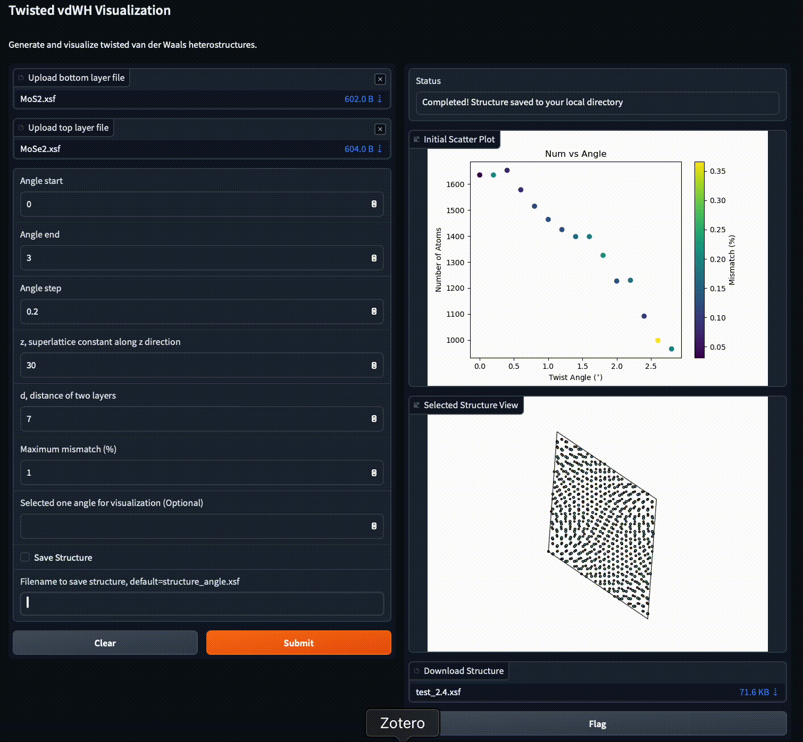

# Twisted Heterostructure Generation Toolkit
A Python-based solution for generating twisted heterostructures through both a Command-Line Interface (CLI) and a Graphical User Interface (GUI). Whether you are a researcher, student, or hobbyist interested in the fascinating world of moiré patterns, this toolkit is designed to provide a flexible and user-friendly approach to exploring these patterns.

First-order moiré geometry uses arbitrary nonsingular 2D lattice matrices with
basis vectors stored as rows. The top lattice includes the requested rotation.
The bottom basis is Gauss-reduced, and each bottom reciprocal vector is paired
with its nearest top reciprocal vector. A one-to-one (unimodular) pairing is
required. For the aligned real-space bases, the moiré lattice is
`A_M = (A_b^-1 - A_t^-1)^-1`, with reciprocal bases `B = 2π A^-T`.
This includes the aligned special case of
[Hermann (2012)](https://doi.org/10.1088/0953-8984/24/31/314210), and supports
different lattice angles and equivalent primitive bases.

Atomic structures are approximants obtained by rounding transformation matrices
in the aligned working bases and averaging the resulting layer cells to a common
cell `C`. For each layer, `F = (C_layer^-1 C)^T`; its principal strains are
`svd(F) - 1`. The reported `Delta` is the maximum absolute principal strain over
both layers. CLI and GUI retain only structures with `Delta*100 <= tolerance`.
`--tolerance` is therefore a strain percentage, and differs from the former
single-vector mismatch measure. This rounding procedure does not search for a
minimum-area or minimum-strain commensurate supercell. Singular moiré geometry,
non-unimodular first-order pairing, and singular rounded cells raise errors.

`-mo K` / `--max-order K` additionally prints higher-index reciprocal components
for every requested angle. Each nonzero bottom vector is paired with its nearest
top vector; pairs with a zero top vector are discarded. Both vectors must lie
within `K` times their layer's shortest reciprocal length. Harmonics and ±
duplicates are removed. The table reports
input-basis indices, Cartesian `q = G_b - G_t`, `2π/|q|`, direction, geometric
order (1, √3, …), and multiplicity of equal-order, equal-period ± pairs. Zero `q`
has infinite period and undefined direction (`nan`). This analysis follows the
higher-index construction discussed by
[Pham et al. (2022)](https://doi.org/10.1038/s41699-022-00321-9); it computes no
Fourier amplitudes and generates no additional atomic structures. Multilayer
and supermoiré analysis are not included.

## Features

- CLI Tool (`twist_cli.py`): generate structures through your terminal or command prompt.
- GUI Tool (`twist_gui.py`): an user-friendly interface, allowing for interactive adjustments and real-time visualization.


## Installation

Use Python 3.12 or newer. To install the CLI and Python package from source:

```sh
git clone https://github.com/i-wli/twistHS.git
cd twistHS
python -m venv .venv
source .venv/bin/activate
python -m pip install .
```

Install `".[gui]"` to add the Gradio interface.

For local development and verification:

```sh
python -m pip install -e ".[test,gui]"
python -m pip install ruff
pytest
ruff check
```

To build and publish a release manually from a clean checkout:

```sh
python -m pip install build twine
python -m build
python -m twine check dist/*
python -m twine upload dist/*
```

## Usage

**Option 1. Using the CLI Tool (`twist_cli.py`)**

Open your command-line interface and run:
```
twist_cli [options]
```
For example, analyze reciprocal components through order 2 and visualize the
structures that pass a 0.5% strain tolerance:
```
twist_cli -b tests/graphene.xsf -t tests/MoS2.xsf -al 0 10 1 -tol 0.5 -mo 2
```
This should open a matplotlib interface:


**Option 2. Using the GUI Tool (`twist_gui.py`)**

To launch the GUI, simply run:
```
twist_gui
```

Once the GUI is open, you should see:


## Supercell construction benchmark

On an Apple M1 with 8 GB of RAM, vectorized atom placement cut the median
time to build both layers of a 1,316,056-atom twisted graphene supercell
from 614.75 s to 0.1545 s. Median peak process memory fell
from 499.0 MiB to 377.6 MiB.
The [benchmark report](docs/benchmarks.md) covers the 5° to 0.1° sweep and
provides the raw measurements and reproduction commands.


