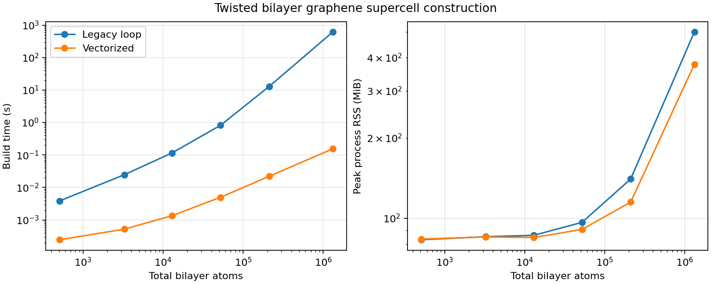

# twistHS

twistHS constructs commensurate moiré supercells from two van der Waals monolayers.
Use the CLI, browser-based GUI, or Python API to scan twist angles and analyze
the geometric moiré components of twisted homobilayers and heterobilayers.

The default coincidence-lattice search enumerates lower-layer sublattices in
Hermite normal form and matches their basis vectors to the rotated upper-layer
lattice. At each requested twist angle, it returns the supercell with the fewest
atoms that satisfies the specified constraints. Ties are resolved by maximum
absolute principal engineering strain, twist-angle deviation, and the integer
transformation matrices. Ranking uses strain as a fraction and twist-angle
deviation in degrees, both rounded to nine decimal places.

- `--tolerance` limits the maximum absolute principal engineering strain
  across both layers. The default is 1%.
- `--angle-tol` limits the angular deviation between the requested and
  effective twist angles. The default is 0.1°.
- `--moire-tol` limits the relative change of first-order moiré wave-vector
  combinations and any enabled higher-index wave vectors. It accepts
  percentages from 0% up to 100%, exclusive, and defaults to 5%.
- `--max-atoms` limits the total number of atoms. The default is 12,000.

Both layers deform into their average cell `C`. The right polar decomposition
of `F = (C_layer^-1 C)^T` gives a rotation `phi` and a stretch whose principal
values minus one give the engineering strains. The effective twist is
`theta_eff = theta + phi_top - phi_bottom`. Both interfaces plot this angle.

At the requested angle, the search pairs each layer's two reduced reciprocal
basis vectors with their nearest vectors in the other layer. This gives two
sets of first-order reference moiré wave vectors. For each set, deformation
may change any linear combination of its wave vectors by at most the specified
percentage of the combination's original length, up to numerical roundoff.
This constrains changes in both magnitude and direction of the reference
moiré wave vectors.

`--moire-order K` sets the reciprocal cutoff for the moiré constraint in
units of each layer's shortest nonzero reciprocal-lattice vector. The default
`1.0` applies the first-order constraint. A finite value above 1 applies the same
`--moire-tol` to the relative change of each finite-period higher-index wave
vector within the cutoff. The scan omits requested twist angles for which no
supercell satisfies the specified constraints.

`--method first-order` constructs supercells by rounding the first-order moiré
cell in aligned primitive bases. It pairs the reduced lower-layer reciprocal
vectors with their nearest upper-layer reciprocal vectors and requires the
pairing matrix to be unimodular. The
real-space moiré cell is `A_M = (A_b^-1 - A_t^-1)^-1` in the aligned bases.
This method uses the strain limit to filter the scan. Singular
moiré geometry, invalid pairing, and singular rounded cells raise errors.
[Hermann (2012)](https://doi.org/10.1088/0953-8984/24/31/314210)

`-mo K` / `--max-order K` reports geometric moiré components at each requested
twist angle independently of supercell construction. For each layer, the
analysis pairs every nonzero reciprocal-lattice vector within the cutoff with
its nearest vector in the other layer. It combines both sets and retains
pairs with two nonzero vectors whose lengths are at most `K` times the
shortest nonzero reciprocal-lattice vector of their respective layers. The
analysis removes harmonics and counts each ± pair once.

The table reports indices in the input reciprocal bases, the Cartesian wave
vector `q = G_b - G_t`, the period `2π/|q|`, the azimuth, the geometric order
(1, √3, …), and the multiplicity of ± pairs with the same order and period.
Zero `q` has infinite period and undefined azimuth (`nan`). The analysis
cutoff is independent of `--moire-order`, which controls the moiré constraint
during coincidence-lattice search. [Pham et al. (2022)](https://doi.org/10.1038/s41699-022-00321-9)

## Installation

Use Python 3.12 or newer. To install the CLI and Python package from source:

```sh
git clone https://github.com/i-wli/twistHS.git
cd twistHS
python -m venv .venv
source .venv/bin/activate
python -m pip install .
```

Install `".[gui]"` to add the Gradio interface.

Install `".[jax]"` to enable the optional JAX search backend. Select it with
`--backend jax` on the CLI, `backend="jax"` in `HSGenerator`, or `jax` in
the GUI's search backend menu. Both backends use double precision.
For GPU execution, install a JAX build for your GPU and select the JAX
backend. On NVIDIA CUDA, set `JAX_PLATFORMS=cuda` before launching twistHS
to require CUDA.

For local development and verification:

```sh
python -m pip install -e ".[test,gui]"
python -m pip install ruff
pytest
ruff check
```

To build and publish a release manually from a clean checkout:

```sh
python -m pip install build twine
python -m build
python -m twine check dist/*
python -m twine upload dist/*
```

## Usage

### Command-line interface

```sh
twist_cli --help
twist_cli -b tests/graphene.xsf -t tests/MoS2.xsf -al 0 10 1 -tol 0.5 -mo 2
```

This example samples the interval [0°, 10°) in 1° increments, applies a
0.5% strain limit, and reports geometric moiré components through reciprocal
cutoff 2. Use `-a ANGLE [ANGLE ...]` for an explicit list of requested twist
angles or `-al START STOP STEP` for a half-open interval. The step must point
from the start toward the stop. Choose one mode per invocation.

Select a point in the Matplotlib plot to inspect the atomic structure and
export the supercell. If the point corresponds to multiple scan results,
select the requested twist angle in the structure view.

### Graphical interface

```sh
twist_gui
```

Upload the lower- and upper-layer primitive cells in an ASE-readable format.
Enter the start, stop, and step in degrees, then select **Scan twist angles**.
Set the construction method, coincidence-lattice search parameters, and optional
reciprocal cutoff for component analysis under **Construction and reciprocal-space
analysis**. Select a result to preview the atomic structure, then select
**Prepare supercell download**.

### Shared geometry and export

The default out-of-plane supercell lattice parameter is 30 Å. The default
interlayer distance is 7 Å, measured from the lower- to the upper-layer
midplane. Each layer's midplane lies halfway between its lowest and highest
atoms. Set these values with `-z` and
`-d` in the CLI or with the corresponding fields in the GUI.

Both interfaces export to `structure_<requested angle>.xsf` by default, with
the angle in degrees to two decimal places. Use `-w` for a custom CLI export
path or **Download filename** in the GUI. ASE infers the format from the file
extension. With a custom filename, use `-o` or **ASE output format** to
specify an explicit format such as `lammps-data`.

### Python API

```python
from ase.io import read
from twistHS.lib.algorithm import HSGenerator

generator = HSGenerator(read("tests/graphene.xsf"), read("tests/MoS2.xsf"),
                        tolerance=1.0, angle_tol=0.1, moire_tol=5.0,
                        moire_order=4.0, max_atoms=12_000)
atoms, strain, theta_eff = generator.gen_supercell(5, super_z=30, delta_z=7)
for requested_angle, atoms, strain in generator.scan([4, 5, 6], super_z=30, delta_z=7):
    print(requested_angle, atoms.info["theta_eff"], len(atoms), 100 * strain)
```

`gen_supercell` returns the maximum absolute principal engineering strain as
a fraction and raises `ValueError` if the search finds no matching supercell. Its `delta_z` argument and the one in `scan` set the
interlayer distance between layer midplanes. The optional `tolerance` argument to `scan` overrides
the generator's strain limit in percent.

## JAX benchmark

On an NVIDIA A100, JAX sped up full supercell generation by 2.02–2.33× over
single-core NumPy after warm-up in the [two benchmark cases](docs/benchmark-jax.md).

## Supercell construction benchmark

On an Apple M1 with 8 GB of RAM, vectorized atom placement cut the median
time to build both layers of a 1,316,056-atom twisted graphene supercell
from 614.75 s to 0.1545 s. Median peak process memory fell
from 499.0 MiB to 377.6 MiB.
The [benchmark report](docs/benchmark-build.md) covers the 5° to 0.1° sweep and
provides the raw measurements and reproduction commands.


