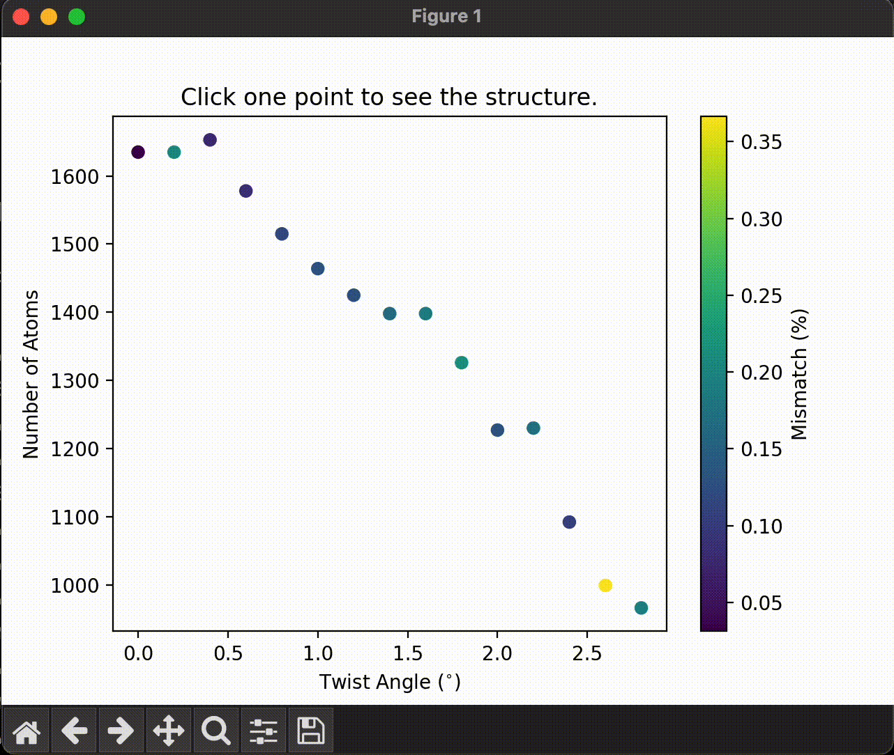

# Twisted Heterostructure Generation Toolkit
A Python-based solution for generating twisted heterostructures through both a Command-Line Interface (CLI) and a Graphical User Interface (GUI). Whether you are a researcher, student, or hobbyist interested in the fascinating world of moiré patterns, this toolkit is designed to provide a flexible and user-friendly approach to exploring these patterns.

The default coincidence search enumerates bottom sublattices in Hermite normal
form and matches their basis vectors to the rotated top lattice. For each
requested angle, it returns the cell with the fewest atoms that satisfies all
four limits. Ties are resolved by maximum strain, effective angle deviation, and
the integer matrices. Strain (as a fraction) and angle deviation (in degrees)
are rounded to nine decimal places for ranking.

- `--tolerance` limits the maximum absolute principal strain across both
  layers. The default is 1%.
- `--angle-tol` limits the difference between requested and effective twist.
  The default is 0.1°.
- `--moire-tol` limits the relative change of moiré wave vectors in any
  direction. It accepts percentages from 0% up to 100%, exclusive, and
  defaults to 5%.
- `--max-atoms` limits the total number of atoms. The default is 12,000.

Both layers deform into their average cell `C`. The right polar decomposition
of `F = (C_layer^-1 C)^T` gives a rotation `phi` and a stretch whose principal
values minus one give the engineering strains. The effective twist is
`theta_eff = theta + phi_top - phi_bottom`. Both interfaces plot this angle.

At the requested angle, the search pairs each layer's two reduced reciprocal
basis vectors with their nearest vectors in the other layer. This gives two
sets of reference moiré wave vectors. For each set, deformation may change
any linear combination of its wave vectors by at most the specified
percentage of the combination's original length, up to numerical roundoff.
This limits changes in both length and direction and keeps a two-dimensional
reference from collapsing into stripes. Angles with no cell within the four
limits are omitted from scans.

`--method first-order` reproduces the v1 rounding approach for aligned
primitive bases. It pairs the reduced bottom reciprocal vectors with their
nearest top reciprocal vectors and requires a unimodular pairing. The
real-space moiré cell is `A_M = (A_b^-1 - A_t^-1)^-1` in the aligned bases.
This mode applies only the strain filter when scanning angles. Singular
moiré geometry, invalid pairing, and singular rounded cells raise errors.
[Hermann (2012)](https://doi.org/10.1088/0953-8984/24/31/314210)

`-mo K` / `--max-order K` additionally prints higher-index reciprocal components
for every requested angle. Each nonzero bottom vector is paired with its nearest
top vector; pairs with a zero top vector are discarded. Both vectors must lie
within `K` times their layer's shortest reciprocal length. Harmonics and ±
duplicates are removed. The table reports
input-basis indices, Cartesian `q = G_b - G_t`, `2π/|q|`, direction, geometric
order (1, √3, …), and multiplicity of equal-order, equal-period ± pairs. Zero `q`
has infinite period and undefined direction (`nan`). This analysis follows the
higher-index construction discussed by
[Pham et al. (2022)](https://doi.org/10.1038/s41699-022-00321-9); it computes no
Fourier amplitudes and generates no additional atomic structures. Multilayer
and supermoiré analysis are not included.

## Features

- CLI Tool (`twist_cli.py`): generate structures through your terminal or command prompt.
- GUI Tool (`twist_gui.py`): an user-friendly interface, allowing for interactive adjustments and real-time visualization.


## Installation

Use Python 3.12 or newer. To install the CLI and Python package from source:

```sh
git clone https://github.com/i-wli/twistHS.git
cd twistHS
python -m venv .venv
source .venv/bin/activate
python -m pip install .
```

Install `".[gui]"` to add the Gradio interface.

Install `".[jax]"` to enable the optional JAX search backend. Select it with
`--backend jax` on the CLI, `backend="jax"` in `HSGenerator`, or `jax` in
the GUI's search backend menu. Both backends use double precision.
For GPU execution, install a JAX build for your GPU and select the JAX
backend. On NVIDIA CUDA, set `JAX_PLATFORMS=cuda` before launching twistHS
to require CUDA.

For local development and verification:

```sh
python -m pip install -e ".[test,gui]"
python -m pip install ruff
pytest
ruff check
```

To build and publish a release manually from a clean checkout:

```sh
python -m pip install build twine
python -m build
python -m twine check dist/*
python -m twine upload dist/*
```

## Usage

**Option 1. Using the CLI Tool (`twist_cli.py`)**

Open your command-line interface and run:
```
twist_cli [options]
```
For example, analyze reciprocal components through order 2 and visualize the
structures that pass a 0.5% strain tolerance:
```
twist_cli -b tests/graphene.xsf -t tests/MoS2.xsf -al 0 10 1 -tol 0.5 -mo 2
```
This should open a matplotlib interface:



**Option 2. Using the GUI Tool (`twist_gui.py`)**

To launch the GUI, simply run:
```
twist_gui
```

Once the GUI is open, you should see:


The GUI uses the requested angle to select or save an individual structure.
In the CLI, click a point to open its structure and save it with the default
XSF filename or a path supplied through `-w`. Use `-o` to specify the format
for that path.

Use `-d` in the CLI or the midplane separation field in the GUI to set the
signed top-minus-bottom separation in Å before periodic wrapping. The default
in the CLI is 7 Å. Each layer's midplane is halfway between its minimum and
maximum z coordinates.

**Python API**

```python
from ase.io import read
from twistHS.lib.algorithm import HSGenerator

generator = HSGenerator(read("tests/graphene.xsf"), read("tests/MoS2.xsf"),
                        tolerance=1.0, angle_tol=0.1, moire_tol=5.0, max_atoms=12_000)
atoms, strain, theta_eff = generator.gen_supercell(5, super_z=30, delta_z=7)
for requested_angle, atoms, strain in generator.scan([4, 5, 6], super_z=30, delta_z=7):
    print(requested_angle, atoms.info["theta_eff"], len(atoms), 100 * strain)
```

`gen_supercell` returns strain as a fraction and raises `ValueError` if search
finds no matching cell. Its `delta_z` argument and the one in `scan` set the
signed midplane separation. The optional `tolerance` argument to `scan` overrides
the generator's strain limit in percent.

## Supercell construction benchmark

On an Apple M1 with 8 GB of RAM, vectorized atom placement cut the median
time to build both layers of a 1,316,056-atom twisted graphene supercell
from 614.75 s to 0.1545 s. Median peak process memory fell
from 499.0 MiB to 377.6 MiB.
The [benchmark report](docs/benchmarks.md) covers the 5° to 0.1° sweep and
provides the raw measurements and reproduction commands.


