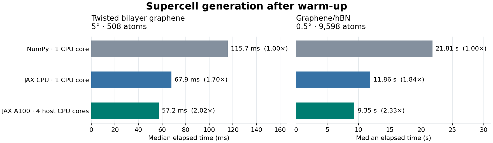

# JAX supercell generation benchmark

Relative to single-core NumPy, JAX on one CPU core sped up full supercell
generation after warm-up by **1.70× for twisted bilayer graphene** and
**1.84× for graphene/hBN**. On an NVIDIA A100, the speedups were **2.02×**
and **2.33×**, respectively.



JAX uses just-in-time compilation for the batched coincidence search kernels.
For twisted bilayer graphene, the first generation call took **117 ms** on
NumPy, **770 ms** on JAX CPU and **768 ms** on JAX A100, in the same
configurations shown above.

## Measurement

The benchmark builds on an AMD EPYC CPU
and one NVIDIA A100 SXM GB GPU with JAX 0.4.38. NumPy and JAX CPU each
used one CPU core. The A100 configuration used four host CPU cores.

The bars show the median of five `HSGenerator.gen_supercell` calls after
warm-up. Timing starts with an initialized generator and includes lattice
rotation, coincidence search and ASE supercell construction. The two cases
use the same limits of 1% strain, 0.1° twist-angle deviation, 5% moiré
wave-vector deviation and 12,000 atoms, with a moiré cutoff of 1.0. Each speedup
is the NumPy median divided by the configuration's median for the same case.

## Recreate the figure

From the repository root with twistHS installed, plot the
[measured timings](benchmark-jax.csv).

```sh
python -m benchmarks.bench_search plot docs/benchmark-jax.csv \
    --output docs/benchmark-jax.png
```
