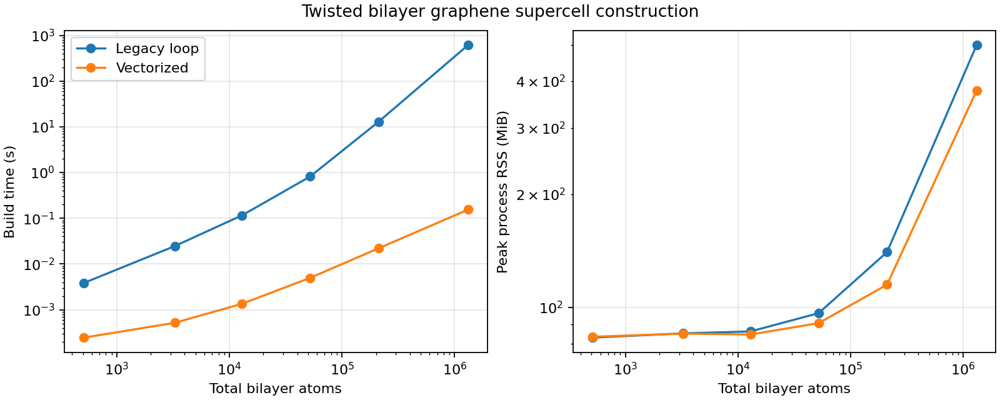

# Supercell construction benchmark

The benchmark builds both layers of twisted bilayer graphene (TBG) at 5°, 2°,
1°, 0.5°, 0.25°, and 0.1°. Both implementations use the same rounded
transformation matrices and lattice-point enumeration. The legacy builder
copies and extends an ASE `Atoms` object at every lattice point. The vectorized
builder broadcasts the Cartesian positions and tiles the atomic numbers.

Timing covers lattice-point enumeration and construction of both layer
`Atoms` objects. Rotation, matrix selection, conversion to the common cell,
and plotting are outside the timed region. Each trial runs in a fresh process.
Peak resident set size (RSS) is the process high-water mark, including Python
and its imported libraries.

## Results

Measured on an Apple M1 with 8 GB of RAM  (arm64). Values are medians of three
independent trials per implementation and angle. Speedups use unrounded
median times.

| Twist angle | Total atoms | Legacy time (s) | Vectorized time (s) | Speedup | Legacy peak RSS (MiB) | Vectorized peak RSS (MiB) |
| ---: | ---: | ---: | ---: | ---: | ---: | ---: |
| 5° | 508 | 0.00384 | 0.000245 | 15.7× | 83.0 | 83.5 |
| 2° | 3,268 | 0.0246 | 0.000518 | 47.5× | 85.2 | 85.1 |
| 1° | 12,936 | 0.116 | 0.00135 | 85.9× | 86.2 | 84.6 |
| 0.5° | 52,008 | 0.817 | 0.00497 | 164× | 96.5 | 90.8 |
| 0.25° | 210,676 | 12.9 | 0.0220 | 584× | 140.2 | 114.9 |
| 0.1° | 1,316,056 | 614.75 | 0.1545 | 3,979× | 499.0 | 377.6 |



[Download the individual measurements](benchmark-build.csv).

## Reproduce

Run from the repository root after installing twistHS. The benchmark uses
process RSS on macOS and Linux.

```sh
python benchmarks/bench_build.py --out-dir benchmark-results
```

The script writes individual trials to `build.csv` and plots their medians in
`build.png`. The default is three trials per implementation and angle. For a
quick run, use `--angles 5 2 1 --repeats 1`.
